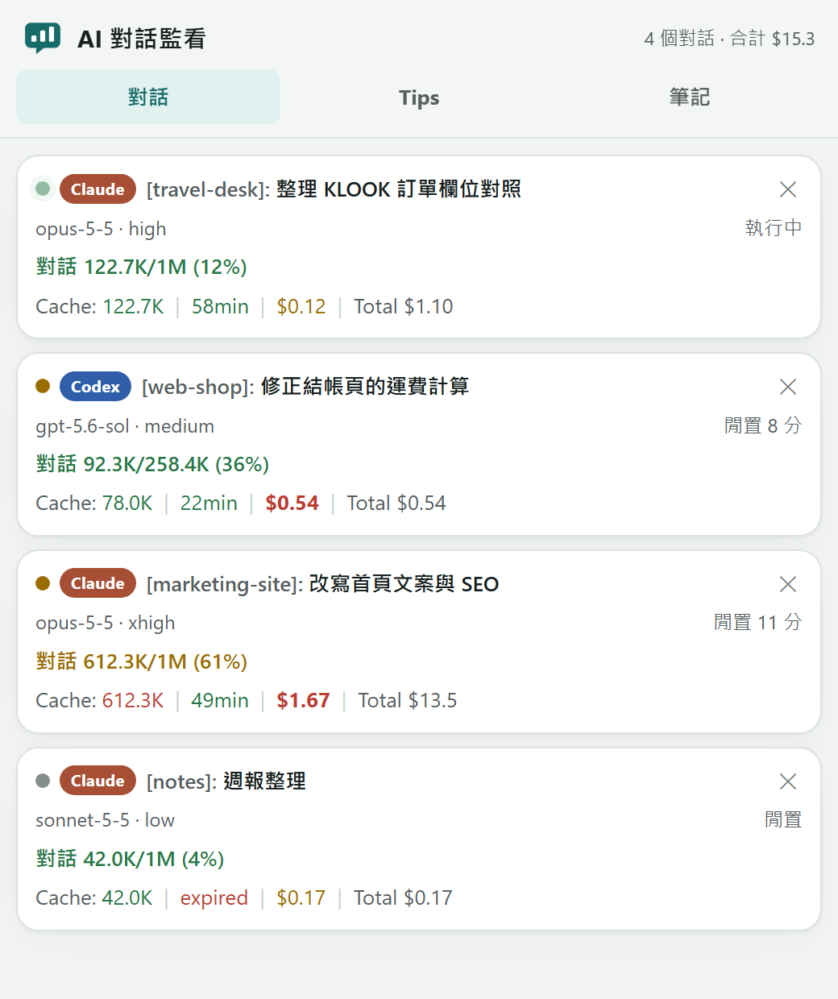
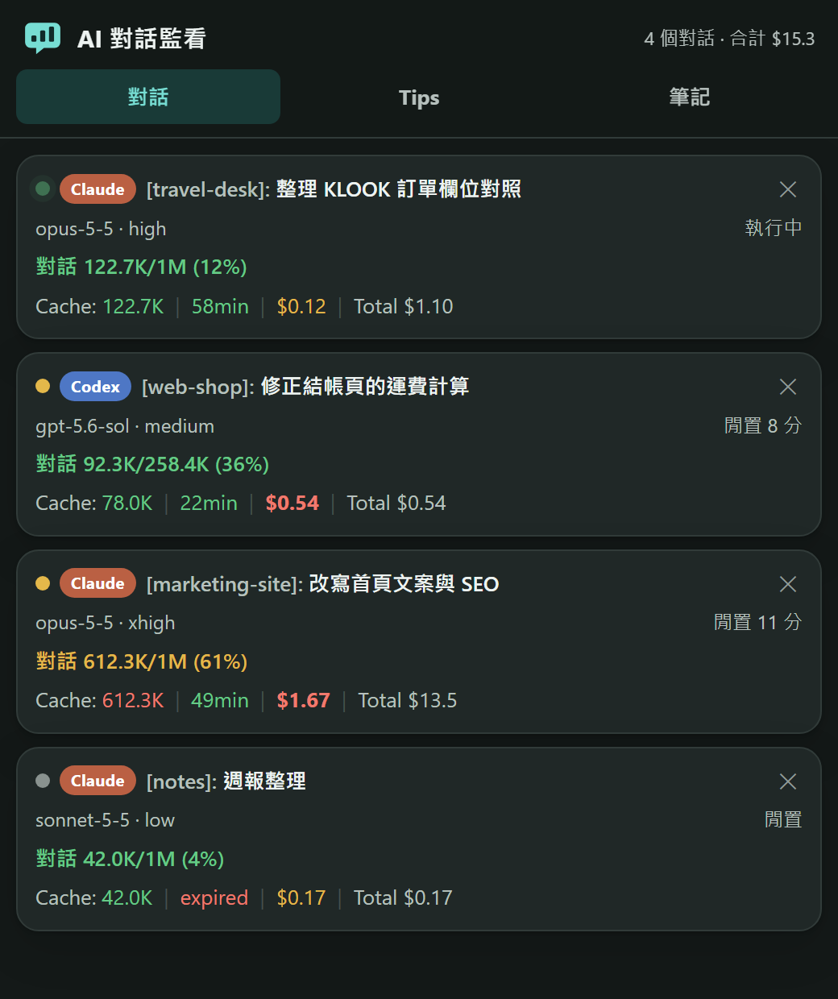
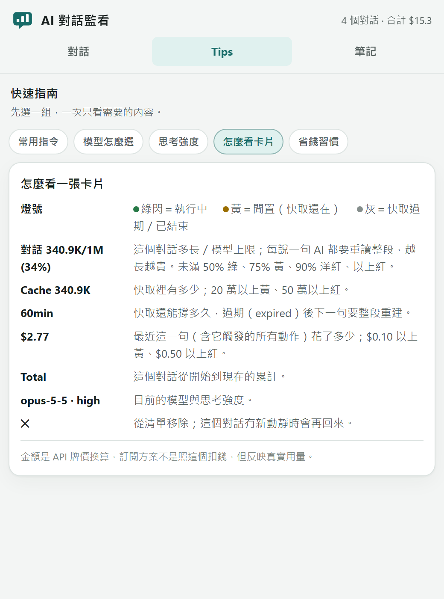
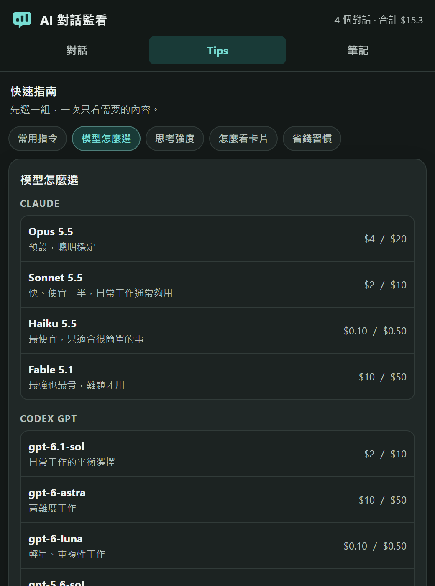
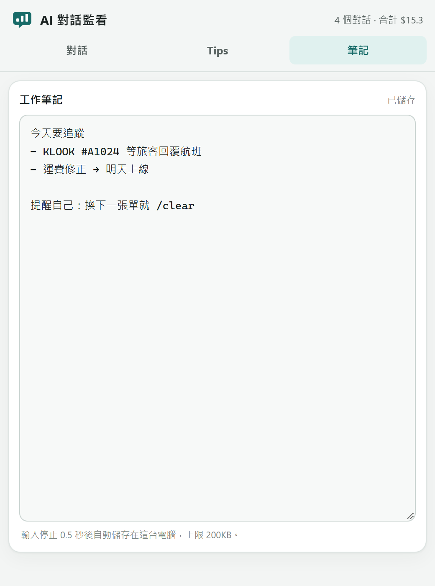

<p align="center">
  
</p>

<h1 align="center">AI 對話監看（aimon）</h1>

<p align="center">
  <b>看見每一句 AI 對話的真實成本。</b><br>
  給 Claude Code 與 Codex 使用者的桌面小面板：對話多長、快取還剩多久、這一句花了多少，一眼就懂。
</p>

<p align="center">
  <a href="https://github.com/youllook/ai-session-monitor/releases/latest"><b>⬇ 下載最新版</b></a>
  ・Windows／macOS（Apple Silicon）
  ・單一執行檔，免安裝任何執行環境
</p>

<p align="center">
  
  &nbsp;
  
</p>

## 為什麼需要它

AI 寫程式、處理文件很方便，但多數人不知道：**同一個對話聊越久，每一句就越貴。**

每送出一句話，AI 都要把整段對話從頭再讀一次；一句話背後又常常是好幾次讀取。對話只有 2 萬 token 時，一句幾分錢；長到 60 萬 token，一句往往就要一美元以上。我們看過有人一個對話用到底，累積讀了 8 億 token 的快取，自己卻完全沒感覺。

問題從來不在工具太貴，而在**看不見**。aimon 把看不見的成本擺到眼前，並在該換對話的時候提醒你。

## 它做什麼

### 📋 一個面板，看完所有對話

每個 Claude Code、Codex 對話一開始就自動出現在清單上，不用設定。

- **燈號**：綠閃＝AI 正在工作、黃＝閒置但快取還在、灰＝快取已過期
- **對話長度**：已用／模型上限（例如 `612.3K/1M (61%)`），越長顏色越警示
- **Cache 倒數**：快取還能撐幾分鐘。過期後再問，整段要重新寫進快取，特別貴
- **這一句多少錢**：最近一句話（含它觸發的所有動作）折合 API 牌價，超過 $0.50 直接標紅
- **Total**：這個對話從開始到現在的累計
- **模型與思考強度**：例如 `opus-5-5 · high`、`gpt-5.6-sol · medium`

### 💸 該換對話時，直接在對話裡提醒

不用一直盯著面板。對話超過 20 萬、50 萬 token，一句超過 $0.50，或快取過期後才回來接著問時，Claude Code／Codex 的對話裡會跳出一行提醒：

```
💸 這句花了 $1.67，對話已經 612.3K：之後每句光重讀就要 $0.12 起跳。
   不需要前面的內容就 /clear，還需要就 /compact。
```

同一級只提醒一次，不會一直吵。

### 💡 Tips：新手也看得懂

<p>
  
  &nbsp;
  
</p>

常用指令（`/clear`、`/compact`、`/cost`、`/model`、`/effort`）、模型怎麼選、思考強度、怎麼看卡片、省錢習慣，分組切換，一次只看需要的。另附導覽 skill：直接問 AI「面板上的數字是什麼意思」，它會照同一套說法回答。

### 📝 隨手筆記



工作中的待辦、要追的單號隨手記下，停手半秒自動存檔，存在自己電腦裡。

## 特色

- **跨工具**：同時支援 Claude Code 與 Codex（終端機版與 Desktop 版）
- **幾乎零設定**：一行指令安裝，之後開對話面板就自動出現（Codex 需在 `/hooks` 信任一次）
- **不打擾**：只在越過門檻時提醒一次；監看程式出錯也絕不卡住你的對話
- **離線、私密**：一切都在自己電腦上（`127.0.0.1`），不連任何外部服務、不上傳任何資料
- **輕巧**：單一執行檔約 7MB，用系統已有的 Chrome／Edge 開成小視窗
- **淺色／深色**：跟著系統主題切換

> 金額是依 API 牌價換算的「真實用量」。訂閱方案不是照這個扣錢，但它反映的是同樣的資源消耗。

## 安裝（每位同仁做一次）

從 [Releases](https://github.com/youllook/ai-session-monitor/releases/latest) 下載對應的檔案（自己編譯的話在 `dist/`）：

| 電腦 | 檔案 |
|---|---|
| Windows | `aimon-windows-amd64.exe` |
| Mac（M 系列晶片） | `aimon-darwin-arm64` |

只出這兩個主流版本。真的遇到 ARM 的 Windows 或 Intel 的 Mac，把下面編譯指令的清單加上 `windows/arm64` 或 `darwin/amd64` 即可。

**Windows**：在終端機執行 `aimon-windows-amd64.exe install claude` 或 `aimon-windows-amd64.exe install codex`。SmartScreen 跳警告的話按「其他資訊 → 仍要執行」。為了相容舊用法，不寫 agent 的 `install` 仍等於 `install claude`。

**Mac**：這個程式沒有 Apple 簽章，第一次要先放行：

```bash
chmod +x aimon-darwin-arm64
xattr -d com.apple.quarantine aimon-darwin-arm64
./aimon-darwin-arm64 install claude   # 或 install codex
```

安裝會做三件事：
1. 把程式複製到固定位置：Windows 是 `%AppData%\ai-session-monitor\bin\`，Mac 是 `~/Library/Application Support/ai-session-monitor/bin/`。
2. 加 4 個 hook：SessionStart、UserPromptSubmit、Stop、SessionEnd。Claude 改 `~/.claude/settings.json`；Codex 改獨立的 `~/.codex/hooks.json`，**不改 `config.toml` 與既有 `notify`**。已存在的設定原檔先備份成 `*.aimon-bak`，別人的 hook 保留，重複安裝不會疊兩份。
3. 放導覽 skill 到對應的 `~/.claude/skills/ai-session-monitor/` 或 `~/.codex/skills/ai-session-monitor/`。

Codex 的使用者 hook 安裝後預設還沒被信任。第一次一般使用前，請開 Codex 執行 `/hooks`，檢視並信任 aimon 的四個 hook；自動化驗收可在已審閱 hook 後用 `--dangerously-bypass-hook-trust`。

之後開 Claude Code 對話時，面板會自動跳出來。關掉了想再開：`aimon panel`。不想自動跳出：設定環境變數 `AIMON_NO_PANEL=1`。

面板預設只監聽 `127.0.0.1:47821`。開發、驗收或預設埠已被舊面板佔用時，可先設 `AIMON_PANEL_ADDR=127.0.0.1:47831` 再執行 `aimon panel`；未設時行為不變。設 `AIMON_NO_WINDOW=1` 只開伺服器、不彈視窗（截圖、開發用）。網址可直接開到指定分頁：`#tips`、`#tips/models`、`#notes`。

移除：`aimon uninstall claude` 或 `aimon uninstall codex`。程式和紀錄留在上面那個資料夾，不要了可以整個刪掉。

### Codex 數字的限制

- 目前以 Codex CLI 0.153.0 的 rollout JSONL 為準；官方將 `transcript_path` 指向的格式列為不穩定介面，Codex 升級後要再跑解析器測試。
- GPT-5.6 以後的快取是「最近寫入或命中後至少 30 分鐘」，OpenAI 可能保留更久；面板倒數顯示這個保證時間，不代表逾時必定沒有快取。
- Codex 的 `systemMessage` 在 UI／事件串流裡是 warning，不是助理回覆內文。`SessionEnd` 可能要到關閉或對話無人連線 30 分鐘後才觸發。

## 開發

需要 Go 1.27 以上。

```bash
go test ./...
go vet ./...
go build -o aimon.exe .
./aimon.exe stats <某個對話記錄.jsonl>   # 驗證：印出面板會顯示的數字
./aimon.exe stats --agent codex <rollout.jsonl>
```

產出發佈檔（CGO 關掉，在 Windows 上就能編出 Mac 版）：

```bash
for t in windows/amd64 darwin/arm64; do
  os=${t%/*}; arch=${t#*/}; ext=""; [ $os = windows ] && ext=.exe
  CGO_ENABLED=0 GOOS=$os GOARCH=$arch go build -trimpath -ldflags "-s -w" -o dist/aimon-$os-$arch$ext .
done
```

| 檔案 | 做什麼 |
|---|---|
| `main.go` | 指令入口 |
| `hook.go` | hook 收事件：更新狀態、算帳、決定要不要提醒 |
| `claude.go` | 增量讀 Claude Code 對話記錄（JSONL），算出 Stats |
| `codex.go` | 增量讀 Codex rollout JSONL，依 response id 去重並算出 Stats |
| `pricing.go` | 單價表與上下文上限 |
| `store.go` | 每個對話一個狀態檔（`<設定資料夾>/ai-session-monitor/sessions/`） |
| `panel.go` | 本機小伺服器，提供面板、對話 API、logo 與筆記 API |
| `web/index.html` | 離線面板畫面（編譯時嵌進程式） |
| `web/logo.svg` | 向量 logo 與 favicon（編譯時嵌進程式） |
| `install.go` | 安裝／移除 Claude settings.json 或 Codex hooks.json；只動自己的 hook |
| `skill/SKILL.md` | 導覽 skill（編譯時嵌進程式） |

Codex 掛勾點、rollout 格式與查證紀錄見 [CODEX.md](CODEX.md)。
